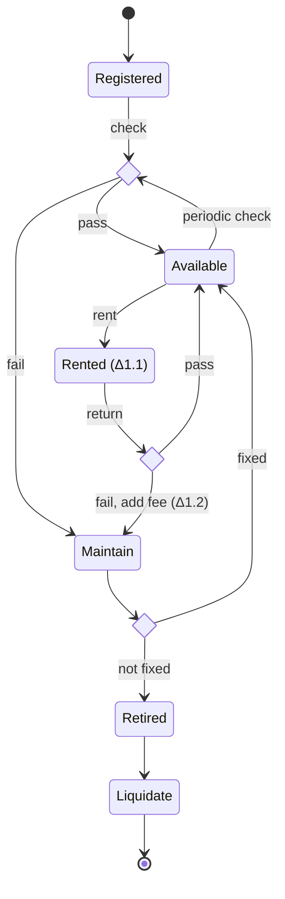
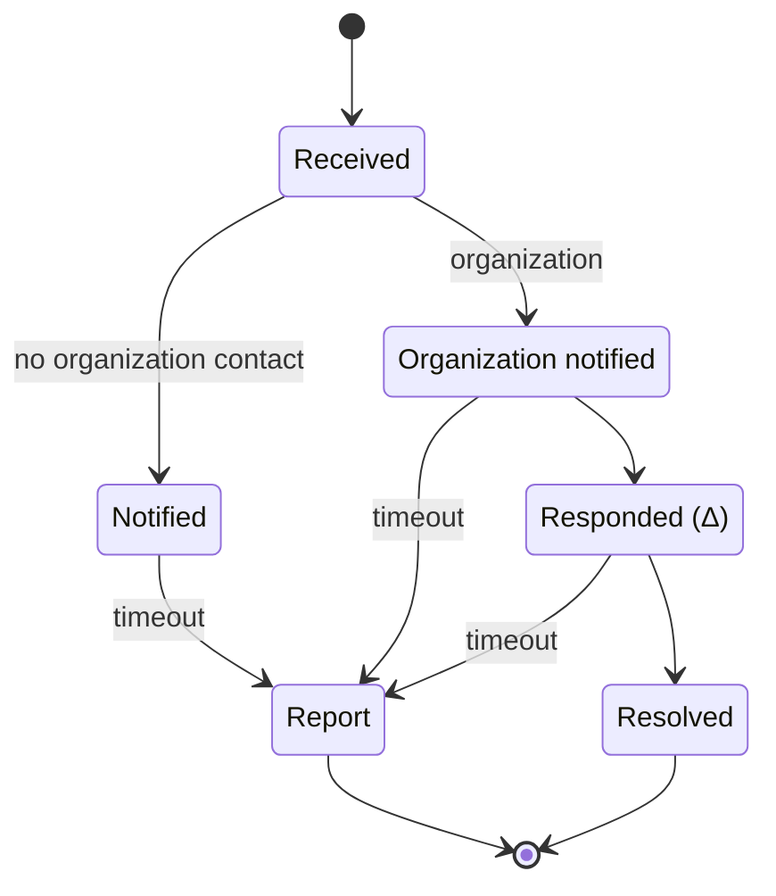
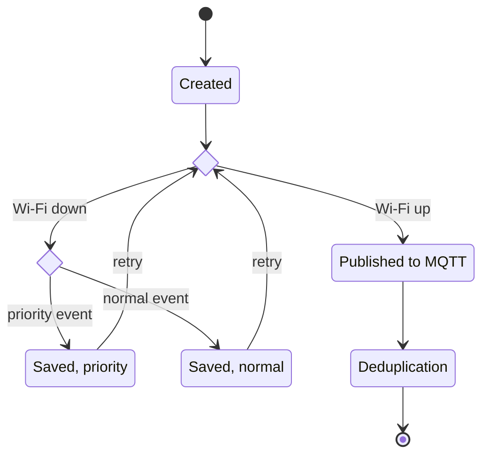

# Whiteboard Target Flows (2026-10-11)

Transcription of two whiteboard photos the leader drew on 2026-10-11, converted to Mermaid. They are
the target shape for the flow and state diagrams, and the input to the Report 4 SDD diagram rework.
They do not yet replace anything in `05-main-flows.md` or the SRS; that reconciliation is SDD work.

> [!NOTE]
> **Superseded where it disagrees with the SRS** (2026-10-23, from the core flow study). This file
> keeps the board as drawn. The SRS and `05-main-flows.md` win on every difference, notably: there is
> no "Book" step in §4, bookings left the scope with D-033 rule 3, and the first payment comes before
> handover (05 §MF-01 step 6); the incident of §2 has twelve states in D-034 and the SRS, not six; §5
> lacks the `RETURNED` state, the reset before inspection, Admin approval of damage above the
> threshold, late and loss charges, and the "no open incident" closing condition.

Sources (gitignored, leader's machine):
`ignore/docs/diagrams/asset-mnt_gateway-fallback_report-incident_statediagram.jpg` and
`ignore/docs/diagrams/rent-lifecycle_return-lifecycle_swimlanes.jpg`.

Notation on the board: `Δ` marks a step that has its own sub-diagram. `Δ1.1` (change to Rented) and
`Δ1.2` (add fee) are numbered; the others (Asset Check, Asset Provision, Confirm asset, Device Check,
Responded) carry an unnumbered `Δ`. Labels below keep the board's wording, expanded only where a
word was abbreviated.

## 1. Asset management (device state)



## 2. Report incident (incident state)



## 3. Gateway fallback (Field Station event path)



## 4. Rent lifecycle

```mermaid
swimlane-beta TB
    subgraph system["System"]
        s1[Asset check Δ]
        s2[Asset provision Δ]
        s3[Change to Rented Δ1.1]
    end
    subgraph staff["TrekLink Staff"]
        t1[Confirm asset Δ]
        t2[Device check Δ]
        t3[Provision to<br/>organization contract]
        t4[Prepare device]
        t5[Handoff]
    end
    subgraph manager["Organization Manager"]
        m1[Book]
        m2[Sign contract]
        m3[Receive]
        m4[Sign handoff contract]
    end
    m1 -->|create request| t1
    t1 --> s1
    s1 --> t1
    t1 --> t2 --> t3 --> m2 --> t4 --> s2 --> s3 --> t5 --> m3 --> m4
```

## 5. Return lifecycle

```mermaid
swimlane-beta TB
    subgraph system["System"]
        s1[Change to Maintain]
        s2[Available]
    end
    subgraph staff["TrekLink Staff"]
        t1{Check devices}
        t2[Compile fee]
        t3[Validate]
        t4[End contract]
    end
    subgraph manager["Organization Manager"]
        m1[Return devices]
        m2[Payment]
    end
    m1 --> t1
    t1 -->|fail| s1
    t1 -->|pass| s2
    s1 -->|add fee Δ1.2| t2
    s2 --> t2
    t2 --> m2 --> t3 --> t4
```

## Reading notes

| Item | Board shows | Transcribed as |
|---|---|---|
| Return check failure | The `✗` branch from the second `Check?` runs into `Maintain`, with "Addfee Δ1.2" written beside it | One transition, `fail, add fee (Δ1.2)` |
| Periodic check | An arrow from `Available` back to the first `Check?`, labelled "Periodic check" | `Available --> intakeCheck : periodic check` |
| Incident lanes | "No contact" leads to `Notified`, "Org." to `Org. Notify` | `no organization contact` and `organization` |
| Gateway retry | Both saved states loop back to `Wifi?` | `retry` |
| Return lifecycle ends | `Change to Maintain` and `Avail.` each also end in a final node, meaning the device continues in the asset flow (§1) | Edges into the fee path only; the device's own path is §1 |
| Rent lifecycle | `Asset Check` and `Confirm asset` have arrows both ways | Two edges, `t1 --> s1` and `s1 --> t1` |

Open for the SDD rework: the `Δ` sub-diagrams are not drawn yet, and each high-level swimlane step
needs a sequence diagram.
